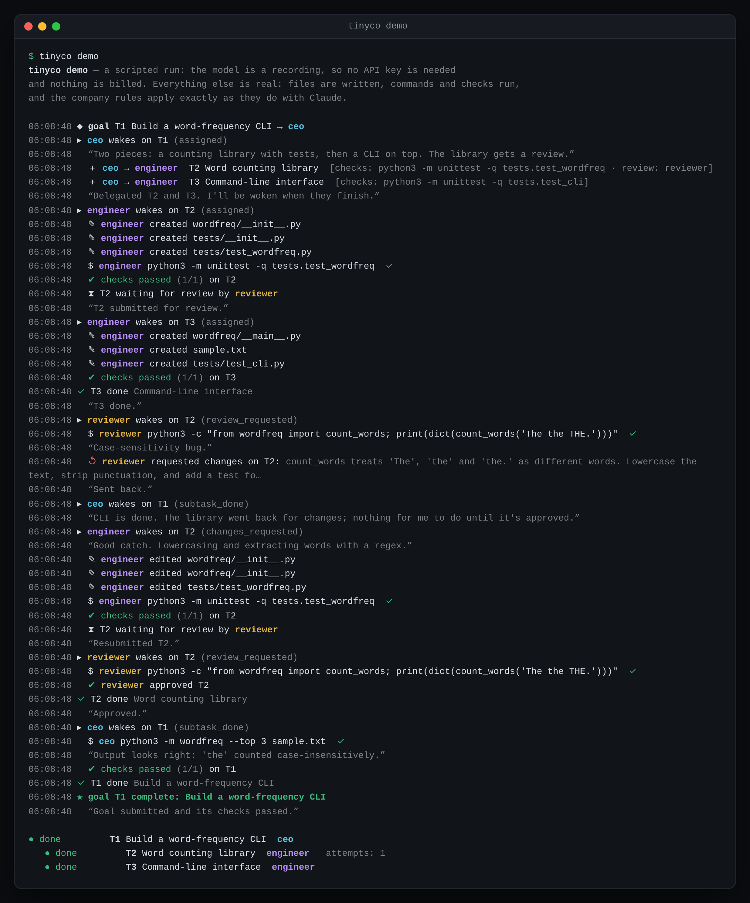
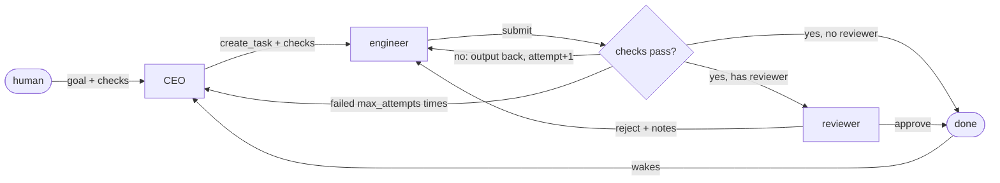
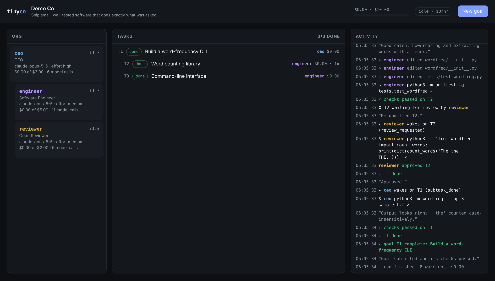

<h1 align="center">tinyco</h1>

<p align="center">
  <b>Run a tiny company of AI agents.</b><br>
  One <code>pip install</code>, one TOML file, an org chart that actually ships, and nothing billed while it's idle.
</p>

<p align="center">
  <a href="#try-it-in-10-seconds">Try it</a> ·
  <a href="#how-it-works">How it works</a> ·
  <a href="#companytoml">Config</a> ·
  <a href="#bring-your-own-agent-claude-code">Claude Code agents</a> ·
  <a href="#the-dashboard">Dashboard</a> ·
  <a href="#safety">Safety</a> ·
  <a href="#faq">FAQ</a>
</p>

<p align="center"></p>

You give the company a goal. The CEO agent breaks it into tasks and hands them to its reports. Engineers write code and run it. Reviewers push back. Every task carries a **definition of done** (a command that has to exit 0, a reviewer, or both), so "done" means the checks passed, not that an agent said so. When there's nothing to do, nothing runs.

```
pip install git+https://github.com/ThePeeps191/tinyco
tinyco init
tinyco goal "Build a CLI that converts CSV files to JSON" --check "python -m pytest -q"
tinyco run
```

## Try it in 10 seconds

No API key needed:

```
pip install git+https://github.com/ThePeeps191/tinyco
tinyco demo
```

`tinyco demo` runs a three-person company (CEO, engineer, reviewer) through a small build with the model swapped for a recording. Everything else is real. Files get written, `unittest` really runs against the code, the reviewer really rejects the first attempt, and the same company rules apply as in a live run. Afterwards, `cd tinyco-demo && tinyco dashboard` to browse what happened.

## Run a real company

```
export ANTHROPIC_API_KEY=sk-ant-...
mkdir acme && cd acme
tinyco init                     # writes company.toml (CEO, engineer, reviewer)
tinyco goal "Build a markdown-to-HTML converter with a CLI" --check "python -m pytest -q"
tinyco run                      # works until the company is idle, then exits
```

`tinyco run` streams what every agent does. When it returns, either the goal is done (its checks passed) or something needs you:

```
tinyco status                   # task tree, spend per agent, anything waiting on you
tinyco inbox                    # questions and reviews for the human
tinyco reply 4 "Use Postgres"   # answer an agent; it picks up on the next run
tinyco approve 1                # if you asked to review the result yourself
```

The code lands in `./workspace`. Templates: `tinyco init -t startup` (default), `-t solo`, `-t research`. More org shapes are in [`examples/`](examples/): a game studio, a Claude Code team, a research desk with web access, and an API shop.

## Why tinyco

[Paperclip](https://github.com/paperclipai/paperclip) showed how many people want to run AI agents as a company, with roles, reporting lines, budgets and tickets. tinyco is the small, opinionated take on that idea. Each design choice below targets a failure that shows up again and again in multi-agent setups:

| Problem | What tinyco does |
|---|---|
| Agents are woken on a timer to look for work, and idle teams keep spending tokens | **No heartbeats.** Agents wake only for events: assigned, subtask finished, review requested, human replied. An idle company makes zero model calls, and `tinyco run` exits. |
| Agents report work as done when it isn't | **Every task needs a definition of done.** `submit` runs the task's checks itself, and a reviewer can reject. Claims don't close tasks. |
| Every wake-up starts cold and re-reads the whole board | **Briefings.** Each wake gets a short, targeted brief: why you're awake, the task, the chain of goals above it, subtask status, recent activity, and the agent's own notes. |
| Finished work doesn't wake the manager, or bounces around forever | Finishing a subtask **wakes its owner**. Duplicate wake-ups are merged. After `max_attempts` failures the task **escalates up the org chart** with the last output attached. |
| Runs that silently do nothing | A run that ends without finishing, delegating or asking is **nudged**, then escalated. |
| Budgets that only stop agents after they've overspent | Spend is checked **before every model call**, per agent and per company. Paused work resumes when you raise the budget. |
| Six weeks of infrastructure | **One Python package** and one SQLite file. No server, no database to run, no Node. |

## How it works



- **Org chart.** Agents are defined in `company.toml`, each with a title, a manager, a model, an effort level and a budget. You can only delegate *down* the chart.
- **Tasks.** Each task has an assignee, an optional reviewer, and checks (shell commands run from the workspace root). An agent can't create a task without a definition of done.
- **Wakes.** A small queue in SQLite. Each wake is one bounded session: the agent gets its brief and its tools, works, and ends its turn. Nothing polls.
- **Tools.** Org tools (`create_task`, `submit`, `review`, `update_task`, `comment`, `ask_human`, `view_task`, `note`) and workspace tools (`list_files`, `read_file`, `write_file`, `edit_file`, `run`). Every agent gets the same tool list on every call, so prompt caching works across the whole company.
- **Memory.** Agents save short notes that appear in every later briefing. Task comments, summaries and check results carry the rest.
- **Git history.** If the workspace is a git repo (`tinyco init` makes one), every finished task is committed with the agent who did it as the author, so `git log` reads like a team's history.
- **Humans.** Agents can `ask_human`. Goals can require your sign-off (`--review human`). Escalations that reach the top land in your inbox.

Everything lives in `.tinyco/state.db`, which you can open in any SQLite browser.

## company.toml

```toml
[company]
name = "Acme"
mission = "Ship small, well-tested software that does exactly what was asked."
budget_usd = 10.0         # hard cap for the whole company
workspace = "workspace"   # where agents read, write and run things
shell = "ask"             # ask | allow | deny
max_attempts = 3          # failed submissions before a task escalates
check_timeout = 300       # seconds per check command
parallel = 1              # agents that may work at the same time
git = true                # commit the workspace when a task is done, authored by the agent

[agents.ceo]
title = "CEO"
effort = "high"           # low | medium | high | xhigh | max
budget_usd = 3.0
instructions = """
Turn each goal into 2-5 concrete subtasks with tests as checks...
"""

[agents.engineer]
title = "Software Engineer"
reports_to = "ceo"
model = "claude-opus-5-5" # any Claude model id
effort = "medium"
web = false               # server-side web search + fetch
runtime = "api"           # api | claude-code
budget_usd = 5.0
max_turns = 40            # model calls per wake-up
```

Any shape of org works, as long as exactly one agent has no `reports_to`. Deeper hierarchies, several specialists, research desks: the `research` template is an editor, a researcher and a fact-checker producing Markdown reports.

Prices for budget accounting live in `tinyco/pricing.py`. Override them per model under `[company.pricing."<model-id>"]` with `input`, `output` and `cache_read` in USD per million tokens.

## Bring your own agent: Claude Code

Any agent can be a [Claude Code](https://code.claude.com) session instead of a direct API agent:

```toml
[company]
shell = "allow"            # headless Claude Code can't stop to ask, so run this in a container/VM

[agents.engineer]
title = "Software Engineer"
reports_to = "ceo"
runtime = "claude-code"    # each wake runs `claude -p` in the workspace
model = "claude-sonnet-5-5"
budget_usd = 5.0
```

Each wake runs `claude -p <briefing> --output-format json` in the workspace. Claude Code does the hands-on work with its own tools (editing, shell, search) and gets tinyco's org tools (`submit`, `create_task`, `review`, `ask_human`, ...) from a small built-in MCP server (`--mcp-config ... --strict-mcp-config`). The rules don't change: checks still decide when a task is done, and failures still escalate. The agent's limits are passed through as `--max-turns` and `--max-budget-usd`, and the run's `total_cost_usd` (Claude Code's own estimate) counts toward tinyco budgets. Claude Code uses whatever login it already has. Mixed companies work too, for example an API CEO directing Claude Code engineers.

## Web access

Set `web = true` on an agent to give it Claude's server-side web search and web fetch tools. The `research` template turns it on for the researcher and the fact-checker. Each search adds $0.01 to the agent's spend, at the list price of $10 per 1,000 searches.

## The dashboard

```
tinyco dashboard
```

<p align="center"></p>

A local web page (standard library only, bound to 127.0.0.1) that follows the company live while `tinyco run` works in a terminal. It shows the org chart with each agent's spend and current task, the task tree with cost per subtree, a live activity feed, and a drawer for each task with its checks, submissions and history. You can create goals, answer questions, and approve or reject work from it.

### Share a run

```
tinyco export -o run.html
```

`tinyco export` writes the dashboard as a single self-contained HTML file with the whole run embedded: org chart, task tree, every event, and cost. It's read-only, has no server behind it, and opens from disk or any static host. It contains your task descriptions, commands and agent messages, so read it before you share it.

## CLI

| Command | |
|---|---|
| `tinyco init [-t startup\|solo\|research]` | create `company.toml` |
| `tinyco goal "..." [--check CMD]... [--review human\|AGENT] [-d DETAILS]` | give the company a goal |
| `tinyco run [-j N] [--yes] [--budget USD] [--max-wakes N] [-v]` | work until idle (`-j`: agents working at once) |
| `tinyco status` | task tree, spend, queue, inbox |
| `tinyco inbox` / `reply ID TEXT` / `approve ID` / `reject ID NOTES` | the human's side |
| `tinyco task ID` / `log [--task ID]` / `org` | inspect |
| `tinyco cancel ID` | cancel a task and its open subtasks |
| `tinyco dashboard [--port N]` | live web dashboard |
| `tinyco export [-o FILE]` | self-contained HTML snapshot of the run, for sharing |
| `tinyco cost` | spend by agent, model, goal and task, with prompt-cache hit rates |
| `tinyco demo [PATH] [--fast]` | scripted demo, no API key |

`-C DIR` before any command points at a company in another directory. Otherwise tinyco searches upward for `company.toml`.

## Safety

Agents write files and run commands, so treat a run like letting a contractor use your terminal.

- `shell = "ask"` (the default) asks you before every command and every agent-written check. `allow` runs them without asking; use it in a container or VM, or pass `tinyco run --yes` for one run. `deny` turns commands off entirely.
- Checks you write yourself (`tinyco goal --check`) always run. Checks written by agents follow the shell policy.
- File tools are confined to the workspace directory. Agents can't write git metadata (`.git/`, `.gitattributes`, `.gitmodules`) or tinyco's own files, and tinyco runs git with hooks and fsmonitor disabled, so the workspace can't make git run code.
- Commands run without `ANTHROPIC_API_KEY` / `ANTHROPIC_AUTH_TOKEN` in their environment.
- Budgets are hard caps checked before each model call.
- The dashboard only answers requests addressed to `127.0.0.1`/`localhost` (which blocks DNS rebinding), and write requests need a custom header, which blocks cross-site forms.
- One `tinyco run` per company at a time, enforced with a lock file.
- Agents with `runtime = "claude-code"` run Claude Code with `--permission-mode bypassPermissions`, so they only run when `shell = "allow"` (or `tinyco run --yes`). Run those companies in a container or VM.

## Cost

The biggest lever is the event-driven design: agents that have nothing to do aren't called. Beyond that:

- **Prompt caching** is on. The system prompt and tool list are identical across calls and each session's history is append-only, so most of the input on later turns is billed at the cached rate.
- **Effort per agent.** Leads at `high`, hands-on roles at `medium` is a sensible start. Lower effort means fewer and terser tool calls.
- **Bounded sessions.** Each wake is capped at `max_turns` calls, and each agent starts from a brief instead of the whole history.

- **Briefs that replace lookups.** Every wake brief includes a compact file tree of the workspace and, after a failed submission, the failing checks' output, so agents don't spend model calls rediscovering either. Managers get a bounded summary of their subtasks (counts, open ones, recent completions with summaries) rather than one line per subtask, however big the tree grows.
- **Batched tool calls.** Agents are told to make independent tool calls in the same turn, which means fewer round trips that re-send the conversation.

Your actual spend depends on the goal and the models. `tinyco cost` breaks it down by agent, model, goal and task, and shows how much of each agent's prompt was served from the cache.

## Performance

tinyco's own overhead per wake (scheduling, SQLite, the brief, running a trivial check) is a few milliseconds. Model calls take seconds, so they're what you're waiting on. Measured with `benchmarks/scheduler.py`: a CEO delegates N subtasks to 10 engineers, using a zero-latency scripted model so only tinyco's own time is counted.

| subtasks | wakes | total | per wake |
|---:|---:|---:|---:|
| 50 | 52 | 0.15 s | 3.0 ms |
| 300 | 302 | 1.1 s | 3.7 ms |
| 1000 | 1002 | 4.7 s | 4.7 ms |

Fifty finished subtasks still wake the CEO only once, because wakes for the same agent and task are merged. Most of what remains is starting a process for each check command. Run `python benchmarks/scheduler.py --tasks 300 --profile` to measure on your machine.

## FAQ

**Which models?** Claude. API agents use the official `anthropic` SDK, with streaming, adaptive thinking, prompt caching and server-side refusal fallbacks. Any Claude model id works per agent. Agents with `runtime = "claude-code"` run through Claude Code instead.

**Do agents run in parallel?** Yes, with `tinyco run -j 3` or `parallel = 3` under `[company]`. Different agents work at the same time, and a single agent never handles two wake-ups at once. The default is 1: runs are easier to follow, and agents can't edit the same files at the same moment. With parallel runs, spend can pass a budget by up to one model call per running agent before the cap stops further calls.

**Can an agent game its own checks?** An engineer could, in principle, edit the tests it's checked against. Give important tasks a reviewer, write top-level checks yourself (`tinyco goal --check`), and keep goal-level tests outside what the engineer is told to change.

**Where's my data?** In `company.toml`, `.tinyco/state.db` and `workspace/`, all in your directory. Apart from calls to the Claude API, nothing leaves your machine.

**What happens if I Ctrl+C?** The current wake goes back on the queue. `tinyco run` picks up where it stopped.

## Status and roadmap

tinyco is alpha. The core loop, the rules and the dashboard are covered by an offline test suite, including a test that drives the real `anthropic` SDK over a mock transport to check the exact requests. Next:

- [ ] More runtimes on the same MCP bridge (other coding-agent CLIs)
- [ ] Scheduled goals (`tinyco goal --every monday`)
- [ ] A git branch per task, merged when it's done
- [ ] More templates

Ideas and PRs welcome.

## Development

```
git clone https://github.com/ThePeeps191/tinyco && cd tinyco
pip install -e ".[dev]"
pytest -q && ruff check .
```

The test suite runs whole companies against `tinyco.scripted.ScriptedModel`, so no API key is needed.

## License

MIT
